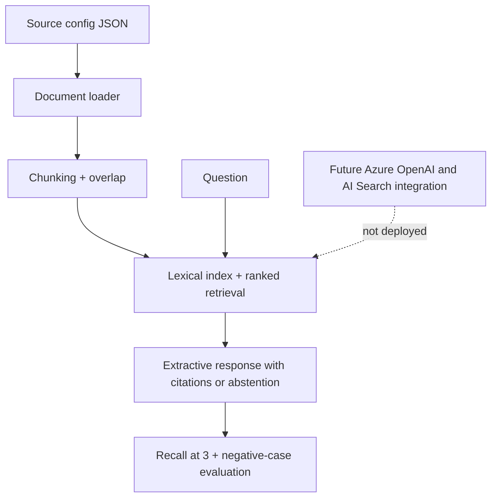

# ADR-001 — Metadata-driven ingestion and retrieval architecture

**Status:** Executable offline lexical retrieval baseline, tests and a labelled evaluation fixture. Azure OpenAI/LangChain wiring is an integration example, not a deployed vector RAG platform.

## Problem and requirements
Document sources differ in format and chunk needs; answers must cite evidence and abstain when retrieval fails. Changing source lists should not require rewriting ingestion logic.

## Decisions
1. JSON config drives approved source IDs, document paths and chunk overlap.
2. A deterministic sparse/lexical retriever supports reproducible baselines without inference cost.
3. Source references are returned explicitly and unmatched queries abstain.
4. Evaluation uses labelled source IDs and Recall@3; the original suite contains three labelled questions and needs a substantially larger evaluation dataset.

## Why retrieval before generation?
Deterministic retrieval has simple evaluation, low cost and clear evidence attribution. Vector embeddings and LangChain may improve semantic recall for paraphrases, but require infrastructure, index freshness, embedding-version strategy and groundedness testing.

## Security/quality concerns
Validate source allowlists, sanitize/segregate document ownership, apply per-tenant ACLs before retrieval, treat retrieved text as untrusted for prompt-injection defense, restrict secrets and PII, and log citations without raw user data. Measure precision@k, recall@k, negative-question abstention and latency with a real labelled corpus.

## Operations and feedback
Track ingestion count, dropped records, index freshness, top-k source coverage, response latency, model cost/token usage (once deployed), human helpfulness feedback and user-reported citation errors. None are production measurements yet.
